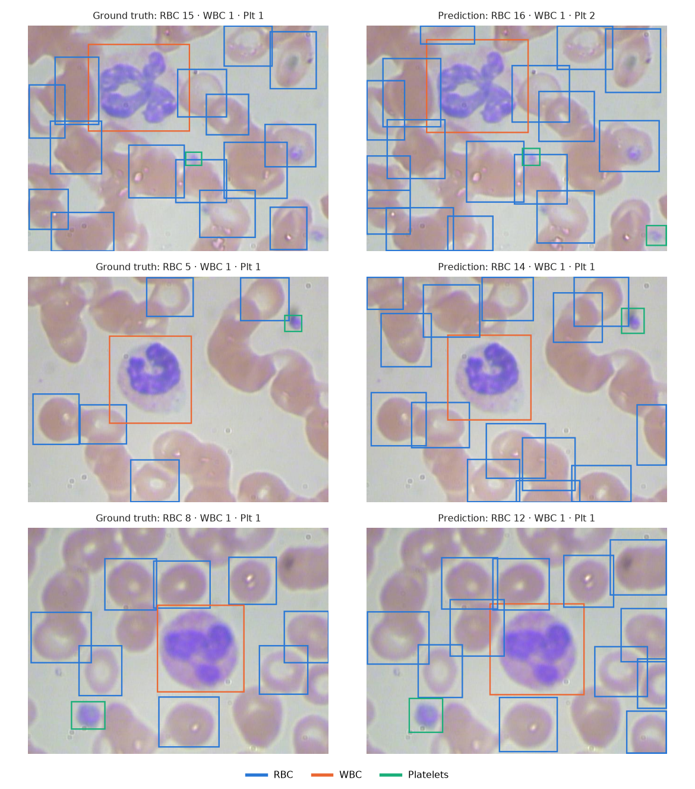
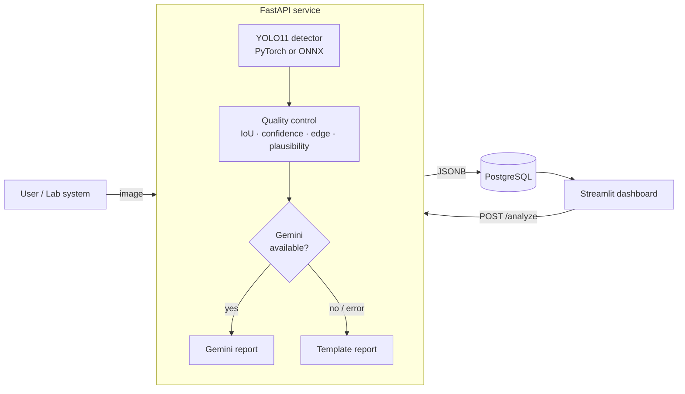

# 🔬 Blood Cell VisionOps

**End-to-end computer-vision system that detects and counts red blood cells, white blood cells and platelets in microscopy images, with automated quality control, LLM-written technical reports (Gemini), a REST API, a PostgreSQL results store and a review dashboard. One `docker compose up` runs it all.**

     

> ⚠️ Research & education project. Not a medical device; not for clinical diagnosis.



---

## Why this project

Manual blood-cell counting under a microscope is slow and subjective. This project builds the whole system a lab would need, not only the model:

| Layer | What it does |
|---|---|
| **Data** | Converts the BCCD Pascal-VOC dataset to YOLO format, with a seeded 70/15/15 split and box sanitisation |
| **Modelling** | Fine-tunes YOLO11n and YOLO11s with microscopy-appropriate augmentation (vertical flips, rotations), cosine LR and early stopping |
| **Evaluation** | Held-out test-set mAP plus **per-image counting error**, the metric users actually care about |
| **Optimisation** | ONNX export, latency benchmark (PyTorch vs ONNX Runtime, CPU vs Apple MPS) |
| **Quality control** | Flags every prediction automatically: low confidence, duplicate/overlapping boxes, border-truncated cells, biologically implausible counts. Result: PASS / REVIEW / FAIL |
| **AI reporting** | Gemini writes a grounded technical report from the *structured measurements only* (no image, no diagnosis), with a deterministic template fallback when the API is unavailable |
| **Serving** | FastAPI with typed Pydantic contracts, upload validation, health check, timing headers, OpenAPI docs |
| **Storage** | PostgreSQL (JSONB detections + QC) for audit trail and analytics |
| **UI** | Streamlit dashboard: live analysis, case review with an interactive confidence filter, population analytics, model leaderboard |
| **Engineering** | Docker Compose, env-based config, auto device selection (CUDA/MPS/CPU), pytest suite, ruff, GitHub Actions CI |

## Architecture



## Results

All numbers are on the **held-out test split** (56 images, 746 labelled cells), never used for training or model selection.

### Detection

| Model | Params | Precision | Recall | mAP@0.5 | mAP@0.5:0.95 | Latency CPU | Latency Apple M4 (MPS) |
|---|---|---|---|---|---|---|---|
| 5-epoch baseline (YOLO11n) | 2.6 M | 0.851 | 0.899 | 0.932 | 0.629 | n/a | n/a |
| **YOLO11n, 100 ep (served)** | **2.6 M** | 0.856 | **0.920** | **0.946** | 0.644 | **18.9 ms (ONNX)** | **10.9 ms** |
| YOLO11s, 100 ep | 9.4 M | 0.881 | 0.917 | 0.946 | 0.650 | 38.5 ms | 15.7 ms |

| Class | mAP@0.5 | mAP@0.5:0.95 |
|---|---|---|
| RBC | 0.912 | 0.644 |
| WBC | 0.994 | 0.785 |
| Platelets | 0.934 | 0.504 |


**Model choice:** YOLO11s has 3.6× the parameters and is 2× slower on CPU, but gains only +0.006 mAP@0.5:0.95, which is within the noise of a 56-image test set. YOLO11n is served.

### Counting: finding and fixing a label-noise problem

Counts are the product, so I measured **per-image count error** against ground truth, and found a surprise:

| Threshold strategy | RBC MAE (bias) | WBC MAE | Platelet MAE |
|---|---|---|---|
| Global conf 0.25 (Ultralytics default) | 7.48 (**+7.45**) | 0.02 | 0.29 |
| **Per-class thresholds calibrated on the val split** | **3.11** (+0.57) | 0.02 | 0.46 |

The model "over-counted" RBCs by +7.5 per image (ground-truth mean: 11.3). Inspecting predictions showed the model was right: **BCCD annotators often skipped RBCs**. In the second row of the image above, the ground truth has 5 RBCs where about 14 are clearly visible. Because counts are compared with these labels, I calibrated a confidence threshold *per class* on the **validation** split (no test leakage). RBC count error fell **−58%** while WBC stayed at 0.02. The thresholds ship in `models/model_info.json` and the API applies them automatically.

> Caveat: this calibration aligns the model with *BCCD's annotation density*. On completely labelled data the optimal RBC threshold would likely be lower. See the [model card](docs/MODEL_CARD.md).

## Quick start

### Option A: full stack with Docker (recommended)

```bash
cp .env.example .env          # add GEMINI_API_KEY for LLM reports (optional)
docker compose up --build -d
```

| Service | URL |
|---|---|
| Dashboard | http://localhost:8501 |
| API docs (Swagger) | http://localhost:8000/docs |
| PostgreSQL | `localhost:5433` (user/pass `bloodcell`) |

The trained model ships in `models/` (PyTorch + ONNX), so no training is needed to run the demo.

Populate the database with the test split:

```bash
make ingest        # requires the local venv; see Option B
```

### Option B: local development

```bash
make install       # Python 3.11 venv + all extras
make data          # clone BCCD + convert to YOLO format
make train         # YOLO11n + YOLO11s, 100 epochs each
make evaluate      # test-set metrics -> reports/metrics/*.json
make promote       # best run -> models/best.pt + best.onnx
make benchmark     # latency table
make api           # http://localhost:8000/docs
make dashboard     # http://localhost:8501
make test          # pytest
```

### API example

```bash
curl -F "file=@BCCD_Dataset/BCCD/JPEGImages/BloodImage_00003.jpg;type=image/jpeg" \
     "http://localhost:8000/analyze?persist=true"
```

```jsonc
{
  "id": 57,
  "filename": "BloodImage_00003.jpg",
  "model_name": "yolo11n_e100 (onnx)",
  "inference_ms": 23.3,
  "total_detections": 19,
  "counts": { "RBC": 16, "WBC": 1, "Platelets": 2 },
  "quality_control": {
    "status": "PASS", "average_confidence": 0.773,
    "low_confidence_count": 1, "overlapping_pair_count": 0,
    "edge_truncated_count": 8, "flags": []
  },
  "report_source": "gemini",          // "template" when no GEMINI_API_KEY
  "ai_report": "### Summary\n...",
  "detections": [{ "class": "RBC", "confidence": 0.9017, "bbox": [508.78, 6.62, 627.13, 143.69] }]
}
```

| Endpoint | Purpose |
|---|---|
| `GET /health` | Model, device, DB and LLM status |
| `POST /predict` | Detection only (fast path, `?conf=` override) |
| `POST /analyze` | Detection + QC + report, optionally persisted |
| `GET /analyses` | Stored history |
| `GET /analyses/{id}` | One stored analysis |

## Design decisions

- **Counting error as a first-class metric.** mAP rewards box quality, but users consume *counts*. `scripts/evaluate.py` reports per-class count MAE against ground truth on every test image.
- **Grounded LLM, never on the critical path.** Gemini only receives aggregates (counts, confidences, QC flags), is told not to diagnose, and is wrapped in a fallback, so an outage or missing key never breaks the API. This is covered by tests.
- **QC before trust.** Every prediction gets a PASS/REVIEW/FAIL status, so reviewers look at the right images first.
- **Domain-aware augmentation.** Microscopy has no "up", so vertical flips and rotations are safe and help with the small dataset (254 training images).
- **One codebase, many runtimes.** All paths and devices come from env vars; the same code runs on an M-series Mac (MPS), a CUDA box, CPU-only Docker and CI.
- **Lean dashboard image.** The dashboard has no torch dependency; it talks to the API and the DB.

## Project structure

```
bloodcell/            Python package
  config.py           env-driven settings, device auto-selection
  schemas.py          Pydantic contracts (Detection, QualityControl, Analysis)
  inference.py        Detector wrapper (PyTorch / ONNX)
  qc.py               vectorised IoU, QC flags and status
  report.py           Gemini report + template fallback
  pipeline.py         detect -> QC -> report
  db.py               PostgreSQL persistence
  api.py              FastAPI app
dashboard/app.py      Streamlit UI
scripts/              prepare_dataset, train, evaluate, promote_model, benchmark, ingest
db/init.sql           schema
docker/               API + dashboard Dockerfiles
tests/                unit, API-contract and model integration tests
models/               served weights (best.pt, best.onnx, model_info.json)
reports/metrics/      evaluation + benchmark JSON
docs/                 MODEL_CARD.md, figures
```

## Limitations & next steps

See [docs/MODEL_CARD.md](docs/MODEL_CARD.md). In short: BCCD is small (364 images, one lab, one stain), has known missing RBC labels, and platelets are tiny, so results won't transfer to other microscopes without re-training. Next steps: SAHI tiled inference for platelets, active-learning loop from REVIEW-flagged cases, WBC sub-type classification, MLflow experiment tracking.

## Acknowledgements

Dataset: [BCCD Dataset](https://github.com/Shenggan/BCCD_Dataset) (MIT). Model: [Ultralytics YOLO11](https://github.com/ultralytics/ultralytics) (AGPL-3.0).
