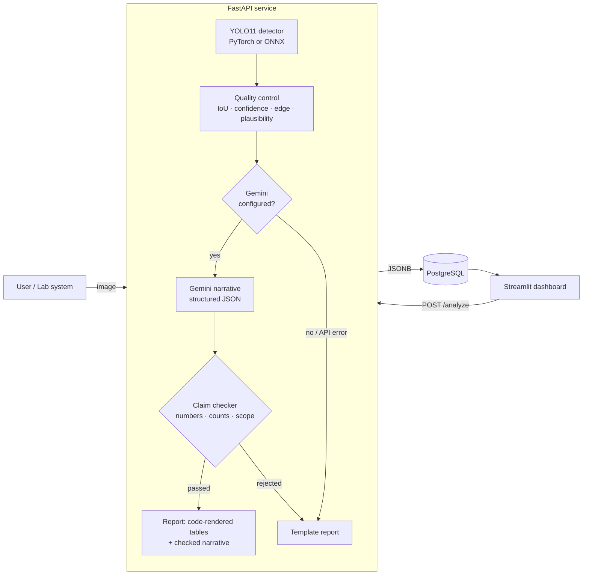
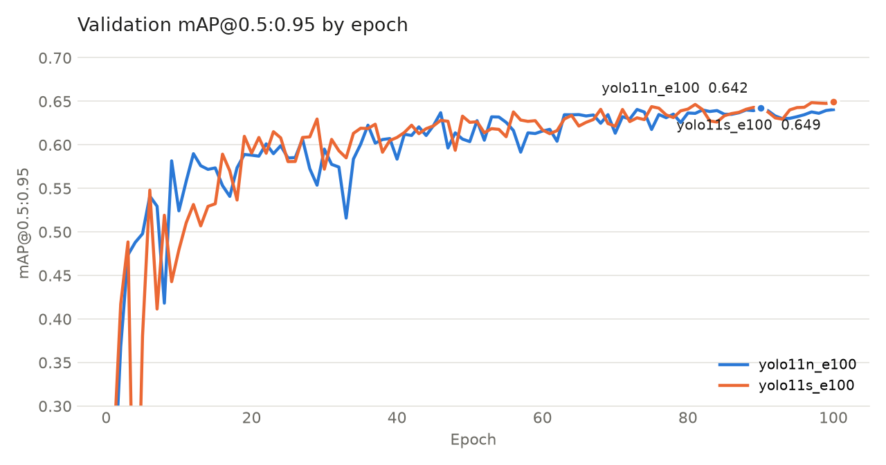

# 🔬 Blood Cell VisionOps

**End-to-end computer-vision system that detects and counts red blood cells, white blood cells and platelets in microscopy images, with automated quality control, LLM-written technical reports (Gemini) whose numbers are checked against the detector output, a REST API, a PostgreSQL results store and a review dashboard. One `docker compose up` runs it all.**

     

> ⚠️ Research & education project. Not a medical device; not for clinical diagnosis.


---

## Why this project

Manual blood-cell counting under a microscope is slow and subjective. This project builds the whole system a lab would need, not only the model:

| Layer | What it does |
|---|---|
| **Data** | Converts the BCCD Pascal-VOC dataset to YOLO format, with a seeded 70/15/15 split and box sanitisation |
| **Modelling** | Fine-tunes YOLO11n and YOLO11s with microscopy-appropriate augmentation (vertical flips, rotations), cosine LR and early stopping |
| **Evaluation** | Held-out test-set mAP plus **per-image counting error**, with **paired image-level bootstrap confidence intervals** for every model comparison |
| **Optimisation** | ONNX export, latency benchmark (PyTorch vs ONNX Runtime, CPU vs Apple MPS) |
| **Quality control** | Flags every prediction automatically: low confidence, duplicate/overlapping boxes, border-truncated cells, biologically implausible counts. Result: PASS / REVIEW / FAIL |
| **AI reporting** | Gemini writes only the *narrative*, as schema-validated JSON, from aggregate measurements (no image, no diagnosis). Every number in it must be **traceable to the detector/QC output**, and per-class and total counts are cross-checked (rule-based, with [known gaps](#checked-ai-reports)); tables are rendered by code; any failure falls back to a template |
| **Serving** | FastAPI with typed Pydantic contracts, upload validation, health check, timing headers, OpenAPI docs |
| **Storage** | PostgreSQL (JSONB detections + QC) for audit trail and analytics |
| **UI** | Streamlit dashboard: live analysis, case review with an interactive confidence filter, population analytics, model leaderboard |
| **Engineering** | Docker Compose, env-based config, auto device selection (CUDA/MPS/CPU), pytest suite, ruff, GitHub Actions CI |

## Architecture



## Results

All numbers are on the **held-out test split** (56 images, 746 labelled cells), never used for training, model selection or threshold calibration. Brackets are **95% confidence intervals** from a paired, image-level bootstrap (B = 2000); method, all comparisons and limitations are in [docs/EVALUATION_UNCERTAINTY.md](docs/EVALUATION_UNCERTAINTY.md).

### Detection

| Model | Params | mAP@0.5 | mAP@0.5:0.95 | Latency CPU | Latency Apple M4 (MPS) |
|---|---|---|---|---|---|
| 5-epoch baseline (YOLO11n) | 2.6 M | 0.933 [0.904, 0.952] | 0.629 [0.600, 0.661] | n/a | n/a |
| **YOLO11n, 100 ep (served)** | **2.6 M** | 0.946 [0.924, 0.961] | 0.644 [0.618, 0.677] | **18.9 ms (ONNX)** | **10.9 ms** |
| YOLO11s, 100 ep | 9.4 M | 0.946 [0.922, 0.963] | 0.650 [0.626, 0.677] | 38.5 ms | 15.7 ms |

| Class (served model) | mAP@0.5:0.95 |
|---|---|
| RBC | 0.644 [0.612, 0.675] |
| WBC | 0.784 [0.751, 0.822] |
| Platelets | 0.504 [0.453, 0.562] |



**Paired comparisons (same resampled images for both models):**

| Comparison | Δ mAP@0.5:0.95 | 95% CI | What the test set supports |
|---|---|---|---|
| YOLO11s − YOLO11n | +0.005 | [−0.008, +0.019] | Not resolved: this test set cannot rank them overall |
| 5-epoch baseline − YOLO11n | −0.015 | [−0.037, +0.004] | Not resolved overall; the longer training's gain is resolved **only for RBC** (−0.030, CI [−0.046, −0.013]) |

**Model choice:** YOLO11s costs 3.6× the parameters and 2× the CPU latency, and its overall accuracy gain is not resolved by this test set. It does count platelets better (count MAE −0.21, CI [−0.38, −0.07]). YOLO11n is served for latency. "Not resolved" is **not** a claim that the models are equivalent; with 56 images, the interval still allows anything from YOLO11s being 0.008 worse to 0.019 better in mAP@0.5:0.95.

### Counting: finding and fixing a label-noise problem

Counts are the product, so I measured **per-image count error** against ground truth, and found a surprise:

| Threshold strategy (served model) | RBC MAE (bias) | WBC MAE | Platelet MAE |
|---|---|---|---|
| Global conf 0.25 (Ultralytics default) | 7.48 (**+7.45**) | 0.02 | 0.29 |
| **Per-class thresholds calibrated on the val split** | **3.11** (+0.57) | 0.02 | 0.46 |
| Paired effect of calibration, 95% CI | **−4.38 [−5.52, −3.16]** | 0.00 (identical) | **+0.18 [+0.05, +0.30]** |

The model "over-counted" RBCs by +7.5 per image (ground-truth mean: 11.3). Inspecting predictions showed the model was mostly right: **BCCD annotators often skipped RBCs**. In the second row of the image above, the ground truth has 5 RBCs where about 14 are clearly visible. Because counts are compared with these labels, I calibrated a confidence threshold *per class* on the **validation** split (no test leakage). RBC count error fell by 4.4 cells per image (−58%), a difference the bootstrap resolves clearly.

**What did not work:** the val-calibrated platelet threshold (0.10) made platelet counting *worse* on test (+0.18 per image, resolved). With only ~1 platelet per image, 54 validation images are too few to calibrate that class reliably. This is an open issue (see [Release status](#release-status)), not something to tune on the test set.

> Caveats: the RBC calibration partly aligns the model with *BCCD's annotation density*; on fully labelled data the optimal RBC threshold would likely be lower. Counting metrics are computed through the exact serving configuration (NMS IoU 0.5), because NMS settings change which boxes survive. See the [model card](docs/MODEL_CARD.md).

### Checked AI reports

Gemini never produces the tables or measurements in a report. It returns a JSON narrative (`summary`, `quality_assessment`, `reviewer_actions`) validated against a Pydantic schema. A rule-based checker (no second LLM) then rejects the narrative if:

- any number cannot be traced to the detector/QC output (fabricated measurements such as cell sizes or haematocrit);
- a number attached to a class or the total contradicts that specific count (e.g. "17 RBCs" when 16 were detected, even if 17 appears elsewhere in the data);
- the summary omits the total count or the QC status;
- it uses clinical or diagnostic terms.

Rejected narratives, invalid JSON, empty or safety-blocked responses and API errors all fall back to the deterministic template, and the API response records why (`report_validation`). 33 tests cover valid, inconsistent, hallucinated, malformed and failed-API cases. In a one-off check (run by hand, not part of the test suite), 112 faithful narratives written from real test-set outputs produced **0 false rejections**.

**What the checker does not catch.** It checks that numbers are *traceable* and that counts tied to a cell class or the total are right. It does not understand meaning, so these pass:

- a real number reused with the wrong meaning or unit (the image width 640 written as "640 cells per microlitre", or another class's share quoted for RBCs);
- a wrong QC figure that happens to equal some other value in the data ("1 overlapping pair" when there are 0 but the WBC count is 1);
- prose that contradicts the QC status while still naming it;
- numbers written as words ("seventeen RBCs");
- clinical wording outside the fixed term list.

The checker is a guard against fabricated and inconsistent figures, not a proof of correctness. The code-rendered tables in the same report are the source of truth. The live Gemini API has not been exercised yet; all LLM paths are tested with recorded outputs.

## Dashboard

<!--
  RELEASE TODO: add a screenshot here, then delete this comment.
  File: docs/assets/dashboard.png (≈1440×900, PNG, < 500 kB).
  Suggested view: "Review" tab on a REVIEW-status image showing the QC badge,
  flags and side-by-side detections. Steps are in docs/RELEASE_CHECKLIST.md.

  
-->

Four tabs: **Analyze** (upload an image; see detections, QC and the checked report), **Review** (stored cases with QC filters and a per-class confidence filter), **Analytics** (count distributions, QC outcomes, latency) and **Model performance** (held-out metrics and diagnostic plots).

## Quick start

### Option A: full stack with Docker (recommended)

```bash
cp .env.example .env          # add GEMINI_API_KEY for LLM reports (optional)
docker compose up --build -d
```

| Service | URL |
|---|---|
| Dashboard | http://localhost:8501 |
| API docs (Swagger) | http://localhost:8000/docs |
| PostgreSQL | `localhost:5433` (user/pass `bloodcell`) |

The trained model ships in `models/` (PyTorch + ONNX), so no training is needed to run the demo.

Populate the database with the test split. The dataset is not in the repository, so this needs the local venv and the data first (see Option B):

```bash
make install       # once
make data          # downloads BCCD and builds the test split
make ingest
```

The dashboard's Review tab works without the dataset, because analysed images are stored in PostgreSQL. The diagnostic plots in the Model performance tab only appear after `make evaluate`.

### Option B: local development

```bash
make install       # Python 3.11 venv + all extras
make data          # clone BCCD + convert to YOLO format
make train         # YOLO11n + YOLO11s, 100 epochs each
make evaluate      # test-set metrics -> reports/metrics/*.json
make stats         # per-image artefacts + paired bootstrap CIs
make promote       # best run -> models/best.pt + best.onnx
make benchmark     # latency table
make api           # http://localhost:8000/docs
make dashboard     # http://localhost:8501
make test          # pytest
```

### API example

```bash
curl -F "file=@BCCD_Dataset/BCCD/JPEGImages/BloodImage_00003.jpg;type=image/jpeg" \
     "http://localhost:8000/analyze?persist=true"
```

```jsonc
{
  "id": 57,
  "filename": "BloodImage_00003.jpg",
  "model_name": "yolo11n_e100 (onnx)",
  "inference_ms": 23.3,
  "total_detections": 19,
  "counts": { "RBC": 16, "WBC": 1, "Platelets": 2 },
  "quality_control": {
    "status": "PASS", "average_confidence": 0.773,
    "low_confidence_count": 1, "overlapping_pair_count": 0,
    "edge_truncated_count": 8, "flags": []
  },
  "report_source": "gemini",          // "template" when no GEMINI_API_KEY
  "ai_report": "### Summary\n...",
  "detections": [{ "class": "RBC", "confidence": 0.9017, "bbox": [508.78, 6.62, 627.13, 143.69] }]
}
```

| Endpoint | Purpose |
|---|---|
| `GET /health` | Model, device, DB and LLM status |
| `POST /predict` | Detection only (fast path, `?conf=` override) |
| `POST /analyze` | Detection + QC + report, optionally persisted |
| `GET /analyses` | Stored history |
| `GET /analyses/{id}` | One stored analysis |

## Design decisions

- **Counting error as a first-class metric.** mAP rewards box quality, but users consume *counts*. `scripts/evaluate.py` reports per-class count MAE against ground truth on every test image.
- **Grounded and checked LLM, never on the critical path.** Gemini only receives aggregates, writes prose only, and every number it writes must be traceable to the detector output before a user sees it. The check is rule-based rather than a second LLM, so it is reproducible and testable, with documented blind spots. An outage, invalid output or failed check never breaks the API.
- **Uncertainty before conclusions.** Model comparisons are paired bootstrap intervals over images, checked against `model.val()` before they are reported, and worded so that "not resolved" is never read as "equivalent".
- **QC before trust.** Every prediction gets a PASS/REVIEW/FAIL status, so reviewers look at the right images first.
- **Domain-aware augmentation.** Microscopy has no "up", so vertical flips and rotations are safe and help with the small dataset (254 training images).
- **One codebase, many runtimes.** All paths and devices come from env vars; the same code runs on an M-series Mac (MPS), a CUDA box, CPU-only Docker and CI.
- **Lean dashboard image.** The dashboard has no torch dependency; it talks to the API and the DB.

## Project structure

```
bloodcell/            Python package
  config.py           env-driven settings, device auto-selection
  schemas.py          Pydantic contracts (Detection, QualityControl, Analysis)
  inference.py        Detector wrapper (PyTorch / ONNX)
  qc.py               vectorised IoU, QC flags and status
  report.py           structured Gemini narrative + template fallback
  report_validation.py deterministic claim checker
  pipeline.py         detect -> QC -> report
  db.py               PostgreSQL persistence
  api.py              FastAPI app
dashboard/app.py      Streamlit UI
scripts/              prepare_dataset, train, evaluate, export_predictions,
                      bootstrap_eval, promote_model, benchmark, make_figures, ingest
db/init.sql           schema
docker/               API + dashboard Dockerfiles
tests/                unit, API-contract and model integration tests
models/               served weights (best.pt, best.onnx, model_info.json)
reports/metrics/      evaluation, bootstrap and benchmark JSON
reports/predictions/  per-image test artefacts (reproduce the CIs without a GPU)
docs/                 MODEL_CARD.md, EVALUATION_UNCERTAINTY.md, RELEASE_CHECKLIST.md, figures
```

## Release status

See [docs/RELEASE_CHECKLIST.md](docs/RELEASE_CHECKLIST.md) for what is verified and what remains before public release.

## Limitations & next steps

See [docs/MODEL_CARD.md](docs/MODEL_CARD.md). In short: BCCD is small (364 images, one lab, one stain), has known missing RBC labels, and platelets are tiny, so results won't transfer to other microscopes without re-training. Next steps: SAHI tiled inference for platelets, active-learning loop from REVIEW-flagged cases, WBC sub-type classification, MLflow experiment tracking.

## Acknowledgements

Dataset: [BCCD Dataset](https://github.com/Shenggan/BCCD_Dataset) (MIT). Model: [Ultralytics YOLO11](https://github.com/ultralytics/ultralytics) (AGPL-3.0).
