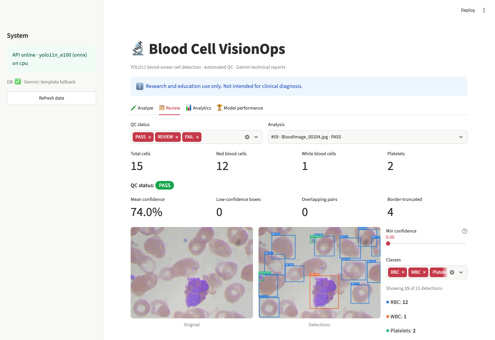
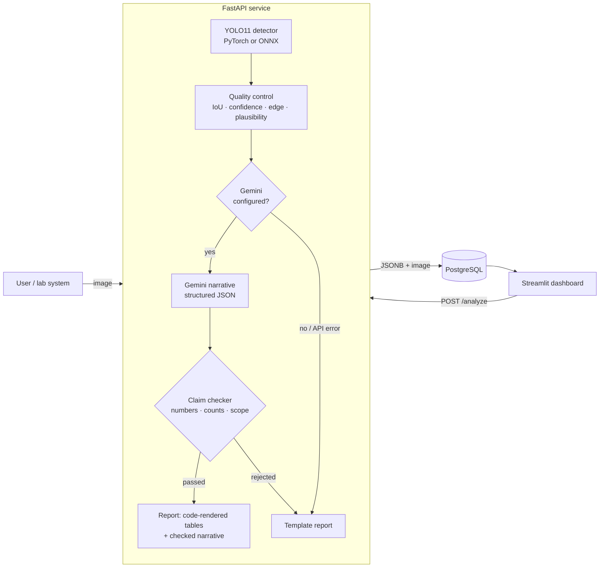

# 🔬 Blood Cell VisionOps

**An end-to-end computer-vision system that detects and counts red blood cells, white blood cells and platelets in microscopy images, flags unreliable results automatically, and writes an LLM report whose numbers are checked against the detector output.**

    

> ⚠️ Research and education project. Not a medical device, not validated for clinical use, and not for diagnosis.



*The Review tab on a held-out BCCD image: per-class counts, the automated QC result, and the original image next to the model's detections (blue = RBC, orange = WBC, green = platelets), served by the API from the ONNX model.*

## Key capabilities

- **Detection and counting:** a fine-tuned YOLO11n model, served as PyTorch or ONNX.
- **Automated quality control:** every image gets PASS, REVIEW or FAIL from confidence statistics, overlapping boxes, border-truncated cells and plausibility rules.
- **Grounded LLM reports:** Gemini writes only the narrative, as schema-validated JSON; a rule-based checker rejects fabricated or inconsistent numbers, and a template takes over on any failure.
- **Honest evaluation:** held-out test metrics, per-image counting error, and paired bootstrap confidence intervals for every model comparison.
- **A complete service:** REST API, PostgreSQL audit trail, review dashboard, Docker Compose, tests and CI.

## Architecture



**Stack:** Python 3.11 · Ultralytics YOLO11 · PyTorch · ONNX Runtime · FastAPI · Pydantic · Google Gemini (`google-genai`) · PostgreSQL 16 · Streamlit · Docker Compose · pytest · ruff · GitHub Actions.

## Quick start

### Run the stack (Docker)

```bash
cp .env.example .env          # optional: add GEMINI_API_KEY for LLM reports
docker compose up --build -d
```

| Service | URL |
|---|---|
| Dashboard | http://localhost:8501 |
| API docs (Swagger) | http://localhost:8000/docs |
| PostgreSQL | `localhost:5433` |

The trained model ships in `models/`, so no training is needed. All ports bind to `127.0.0.1`; if one is taken, set `API_PORT`, `DASHBOARD_PORT` or `DB_PORT` in `.env`. Upload any blood-smear image in the dashboard's **Analyze** tab, or call the API:

```bash
curl -F "file=@your_smear.jpg;type=image/jpeg" "http://localhost:8000/analyze"
```

Response for BCCD image `BloodImage_00003.jpg` from the Docker stack (abridged):

```jsonc
{
  "id": 57,
  "model_name": "yolo11n_e100 (onnx)",
  "total_detections": 19,
  "counts": { "RBC": 15, "WBC": 1, "Platelets": 3 },
  "quality_control": {
    "status": "PASS", "average_confidence": 0.7421,
    "low_confidence_count": 2, "overlapping_pair_count": 0,
    "edge_truncated_count": 5, "flags": []
  },
  "report_source": "template",        // "gemini" when a key is set and the narrative passes the check
  "report_validation": { "status": "not_applicable", "numbers_checked": 0, "issues": [] },
  "ai_report": "### Summary\n...",
  "detections": [{ "class": "RBC", "confidence": 0.8997, "bbox": [315.06, 88.98, 428.53, 199.45] }]
}
```

| Endpoint | Purpose |
|---|---|
| `GET /health` | Model, device, thresholds, DB and LLM status |
| `POST /predict` | Detection only (`?conf=` overrides the thresholds) |
| `POST /analyze` | Detection + QC + report, stored unless `?persist=false` |
| `GET /analyses`, `GET /analyses/{id}` | Stored history |

### Reproduce from scratch (local)

```bash
make install       # Python 3.11 venv with all extras
make data          # clone BCCD and convert it to YOLO format (seeded 70/15/15 split)
make train         # YOLO11n and YOLO11s, up to 100 epochs each
make evaluate      # test-set metrics -> reports/metrics/
make stats         # per-image artefacts + paired bootstrap confidence intervals
make promote       # best run -> models/best.pt and best.onnx
make ingest        # analyse the test split into PostgreSQL (stack must be running)
```

`make stats` can be re-run from the committed files in `reports/predictions/` without a GPU or the dataset.

## Data and model provenance

- **Dataset:** [BCCD](https://github.com/Shenggan/BCCD_Dataset), 364 annotated 640×480 images of stained blood smears, published under the MIT licence. Its README credits the original images to two earlier GitHub repositories; their terms are not documented there. The dataset is not redistributed here.
- **Split:** 254 train / 54 validation / 56 test images, seeded and split by image.
- **Model:** YOLO11n fine-tuned from Ultralytics' COCO-pretrained `yolo11n.pt` (early-stopped at 84 epochs; cosine learning rate; flips and ±10° rotation, since microscopy has no fixed orientation). YOLO11s was trained the same way for comparison.
- **Served files:** `models/best.pt`, `models/best.onnx` and `models/model_info.json` (source run, SHA-256 hashes, thresholds).

Details are in the [model card](docs/MODEL_CARD.md) and [third-party notices](THIRD_PARTY_NOTICES.md).

## Results

All numbers are on the **held-out test split** (56 images, 746 labelled cells), which was not used for training, model selection or threshold calibration. Brackets are 95% confidence intervals.

### Detection

| Model | Params | mAP@0.5 | mAP@0.5:0.95 | CPU latency | Apple M4 GPU latency |
|---|---|---|---|---|---|
| 5-epoch baseline (YOLO11n) | 2.6 M | 0.933 [0.904, 0.952] | 0.629 [0.600, 0.661] | n/a | n/a |
| **YOLO11n (served)** | **2.6 M** | 0.946 [0.924, 0.961] | 0.644 [0.618, 0.677] | **18.9 ms (ONNX)** | **10.9 ms** |
| YOLO11s | 9.4 M | 0.946 [0.922, 0.963] | 0.650 [0.626, 0.677] | 38.5 ms | 15.7 ms |

Per-class mAP@0.5:0.95 for the served model: RBC 0.644 [0.612, 0.675], WBC 0.784 [0.751, 0.822], platelets 0.504 [0.453, 0.562]. Latency is the mean over 50 test images on an Apple M4, measured outside Docker.


### Statistical uncertainty and model comparison

Intervals come from a **paired, image-level bootstrap**: the 56 test images are resampled with replacement 2,000 times (seed 42), every model is scored on the same resampled images, and the 2.5th and 97.5th percentiles are reported. The recomputed mAP matches Ultralytics `model.val()` to four decimals, and a test fails if it drifts.

| Paired comparison | Δ mAP@0.5:0.95 | 95% CI | What this test set supports |
|---|---|---|---|
| YOLO11s − YOLO11n | +0.005 | [−0.008, +0.019] | Not resolved |
| 5-epoch baseline − YOLO11n | −0.015 | [−0.037, +0.004] | Not resolved overall; resolved for RBC only (−0.030, [−0.046, −0.013]) |

"Not resolved" means this test set cannot tell the two models apart on that metric. It is **not** evidence that they are equivalent: the interval still allows YOLO11s to be anywhere from 0.008 worse to 0.019 better. YOLO11n is served because it has 3.6× fewer parameters and half the CPU latency; YOLO11s does count platelets better (count error −0.21 per image, [−0.38, −0.07]). Method, all comparisons and limitations: [docs/EVALUATION_UNCERTAINTY.md](docs/EVALUATION_UNCERTAINTY.md).

### Counting error and calibration

Counts are what a user consumes, so each model is also scored on **mean absolute count error per image** against the labels.

| Threshold strategy (served model) | RBC error (bias) | WBC error | Platelet error |
|---|---|---|---|
| One global confidence threshold, 0.25 | 7.48 (+7.45) | 0.02 | 0.29 |
| **Per-class thresholds chosen on the validation split** | **3.11** (+0.57) | 0.02 | 0.46 |
| Paired effect of calibration, 95% CI | −4.38 [−5.52, −3.16] | 0.00 | +0.18 [+0.05, +0.30] |

- **Why RBCs looked over-counted.** At 0.25 the model found 7.5 more RBCs per image than the labels (label mean 11.3). In the figure above, the middle row's labels mark 5 RBCs where about 14 are visible: BCCD's annotators often skipped RBCs. This was judged by inspecting images, not measured against a re-labelled set.
- **What calibration does.** For each class, the threshold that minimises count error on the 54 validation images is chosen (RBC 0.55, WBC 0.15, platelets 0.10) and shipped with the model. RBC error fell by 4.4 cells per image (58%).
- **What did not work.** The platelet threshold made platelet counting slightly *worse* on test. With about one platelet per image, the validation set is too small to calibrate that class. It is left as an open issue and was not tuned on the test set.
- **Caveats.** The RBC threshold partly fits BCCD's sparse labelling, so it would likely be too strict on fully labelled data. Counts depend on the box-suppression (NMS) setting; serving uses the same value (IoU 0.5) the thresholds were chosen with, enforced by a test. These figures are for the PyTorch weights; the ONNX export served in Docker gives slightly different detections (test-split count error 2.62 / 0.02 / 0.41).

## Grounded Gemini reports and their limits

Gemini never sees the image and never produces the tables or measurements in a report. It receives aggregate numbers only and returns JSON (`summary`, `quality_assessment`, `reviewer_actions`) validated against a Pydantic schema. A rule-based checker, with no second LLM, then rejects the narrative if:

- a number cannot be traced to the detector/QC output (for example an invented cell diameter);
- a number attached to a cell class or the total contradicts that count ("17 RBCs" when 16 were detected);
- the summary omits the total count or the QC status;
- it uses a listed clinical or diagnostic term.

A rejected narrative, invalid JSON, an empty or blocked response, or an API error falls back to a deterministic template, and the response records why in `report_validation`.

**This does not prevent every wrong statement.** The checker tests traceability, not meaning. It accepts a real number reused with the wrong meaning or unit, a wrong QC figure that happens to equal another value, prose that contradicts the QC status while naming it, numbers written as words, and clinical wording outside its term list. The code-rendered tables in each report are the source of truth.

**Verification status:** 33 automated tests cover valid, inconsistent, fabricated, malformed and failed-API cases using recorded outputs. **No live Gemini call has been made yet**; `python scripts/live_gemini_check.py` performs one and saves an example report to `docs/examples/`.

## Testing

```bash
make test          # 68 tests: QC maths, API contract, report checker, statistics, NMS alignment, real model
make lint          # ruff
```

The suite runs offline. In a checkout without the dataset, the two real-model tests are skipped. GitHub Actions runs lint, tests and both Docker builds on pushes to `main` and on pull requests.

## Security and limitations

- **Not for clinical use.** No clinical validation, no regulatory clearance, and the model has seen one dataset from one source. Expect worse results on other microscopes, stains or magnifications.
- **Small test set.** 56 images; several differences between models cannot be resolved.
- **Label noise.** Missing RBC annotations make RBC precision and count metrics pessimistic.
- **Not distinguished:** white-cell subtypes, abnormal cells, parasites.
- **Demo-grade deployment.** No authentication or rate limiting, CORS is open, and the default database password is `bloodcell`; ports bind to localhost only. Change these before exposing the stack to a network.
- **Secrets:** `.env` and Streamlit secrets are git-ignored; the Gemini key is read from the environment and is never logged or stored.
- **Stored data:** analysed images are saved in PostgreSQL. Do not upload patient-identifiable images.

## Project structure

```
bloodcell/            config, schemas, inference, qc, report, report_validation, pipeline, db, api
dashboard/app.py      Streamlit UI (no torch dependency)
scripts/              prepare_dataset, train, evaluate, export_predictions, bootstrap_eval,
                      promote_model, benchmark, make_figures, ingest, live_gemini_check
tests/                68 tests
models/               served weights and model_info.json
reports/              metrics (JSON) and per-image test artefacts
docs/                 MODEL_CARD.md, EVALUATION_UNCERTAINTY.md, RELEASE_CHECKLIST.md, figures
```

## Licence

Blood Cell VisionOps is released under the [GNU Affero General Public License v3.0](LICENSE) (AGPL-3.0). If you run a modified version as a network service, the AGPL requires you to offer its source to the users of that service.

Third-party components and their licences are listed in [THIRD_PARTY_NOTICES.md](THIRD_PARTY_NOTICES.md): Ultralytics YOLO code and the fine-tuned weights are AGPL-3.0, and the BCCD dataset is MIT.
